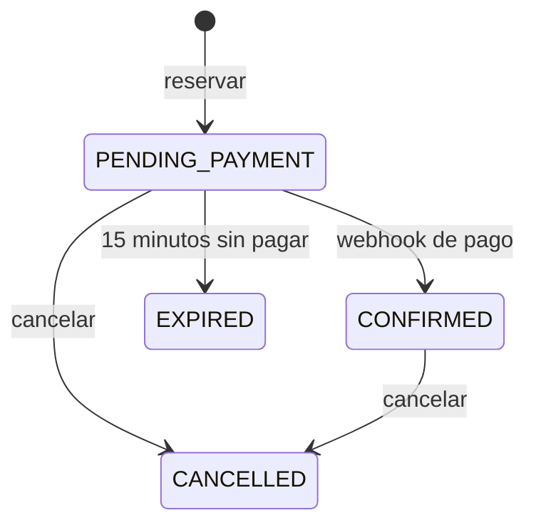

# Reservix

API de reservas y pagos para clases con plazas limitadas, construida con Java 21 y Spring Boot. Garantiza que nunca se vendan más plazas de las disponibles, aunque cientos de personas reserven a la vez.

## Qué demuestra

- **Concurrencia:** bloqueo de fila en PostgreSQL y un índice único parcial.
- **Pagos:** Stripe Checkout en modo de pruebas y webhooks firmados e idempotentes.
- **Fiabilidad:** patrón *outbox* para que ninguna notificación se pierda.
- **Seguridad:** Spring Security, JWT y roles.
- **Calidad:** JUnit, Mockito y Testcontainers con una base de datos real.

## Flujo de una reserva



## Puesta en marcha

Necesitas Java 21, Maven y Docker.

```bash
cp .env.example .env   # rellena los valores
docker compose up -d --build
```

La documentación de la API queda en <http://localhost:8080/swagger-ui.html>.

## Tests

```bash
mvn verify
```

Docker debe estar en marcha. Uno de los tests lanza 40 reservas simultáneas sobre 5 plazas y comprueba que solo se crean 5.

## Prueba de carga

```bash
k6 run -e SESSION_ID=1 load/reservas.js
```
